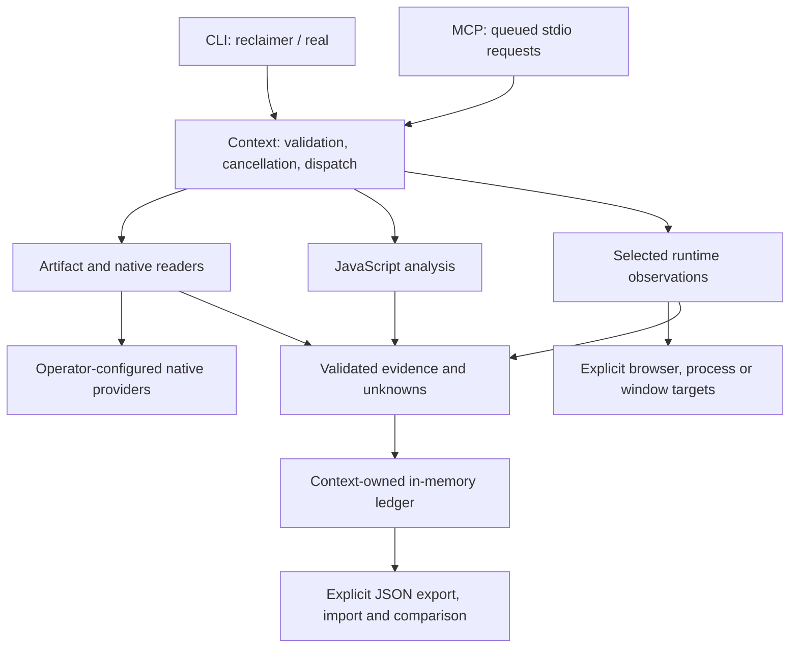

# Reclaimer architecture

Reclaimer is a local investigation application. It reads selected artifacts,
observes explicitly selected runtime scenarios, and retains evidence for comparison.
The implementation is separate from Mega-Crossover's control plane.

The compatibility boundary is the existing 95 CLI commands, 139 MCP operations
and six prompts. The Reclaimer executable and legacy real alias reach the same
engine. Public contract files remain the authoritative request/response definitions.

## Components and data flow

| Component | Responsibility | Implementation |
| --- | --- | --- |
| Entry points | Resolve CLI routes or start stdio MCP | [scripts/reclaimer.mjs](scripts/reclaimer.mjs), [lib/cli.mjs](lib/cli.mjs), [lib/protocol.mjs](lib/protocol.mjs) |
| Engine and context | Compose handlers; validate input and successful output; retain evidence | [lib/engine.mjs](lib/engine.mjs), [lib/core.mjs](lib/core.mjs) |
| Static investigation | Bounded file parsing and explicit provider bridges | [Artifact design](docs/architecture/ARTIFACTS.md) |
| JavaScript investigation | Syntax, imports, source maps, relationships and reconstruction obligations | [JavaScript design](docs/architecture/JAVASCRIPT.md) |
| Runtime investigation | Selected browser, inspector, PTY, debugger and Windows UI observations | [Runtime design](docs/architecture/RUNTIME.md) |
| Evidence storage | Context-scoped maps, content bindings, unknown revisions and JSON exchange | [lib/evidence.mjs](lib/evidence.mjs), [storage decision](decisions/ADR-002-database.md) |

MCP requests share one context and execute through a queue. Cancellation uses
request abort signals. CLI invocations create their own engine context; a command
does not implicitly share an in-memory ledger with a later process.

## Recovery boundaries

NativeAOT readers reconstruct supported bytes, decode embedded metadata and
validate supported method-table associations. Names require a TypeMap token,
CommonFixups pointer, supported layout and recorded hash/bucket agreement.
Generated aliases and existing IDs stay available. Type metadata and static
storage observations do not prove runtime loading, executable method targets or
original managed field offsets.

Swift readers interpret selected Mach-O metadata and supported serialized 0.903
module records. Nominal declarations, actors, supported inheritance and genuine
globals can enter the normalized schema. Member kinds or unknown access values
that the schema cannot represent stay in raw evidence with explicit dispositions.
Reading declarations does not follow serialized source paths or run a compiler.

See the [NativeAOT identity scope](docs/verification/NATIVEAOT_IDENTITY.md) and
[Swift declaration scope](docs/verification/SWIFT_DECLARATIONS.md) for exact limits.

## Ownership and authority

Artifact reads and provider output retain their documented selected-source
bindings. Supported branches apply their documented resource, integrity and
cancellation controls. The new recovery paths stage results before publishing
session annotations and evidence; Context dispatch is not a general transaction.
Content digests establish internal consistency; they do not establish caller
identity, signing trust, execution truth or permission.

Local CLI and stdio MCP execution use the launching operator's host authority.
External providers and runtime endpoints retain their own access requirements.
Static investigation does not execute the selected native artifact; runtime
capture is an explicit capability with its own selected targets and limitations.
The application is not a host sandbox.

Private provider settings, toolchains, generated artifacts and raw machine receipts
stay outside the curated public snapshot. Required dependency notices remain in
[THIRD_PARTY_NOTICES.md](THIRD_PARTY_NOTICES.md). Mega-Crossover retains only its
external-project metadata and receipts; this repository owns the product.

## Decisions and verification

- [ADR-001: modular local architecture](decisions/ADR-001-architecture.md)
- [ADR-002: in-memory evidence with explicit JSON persistence](decisions/ADR-002-database.md)
- [ADR-003: local execution authority and external authentication boundaries](decisions/ADR-003-authentication.md)
- [Completion contract](COMPLETION_CONTRACT.md)
- [Current project status](PROJECT_STATUS.md)

The [independent design record](docs/architecture/INDEPENDENT_DESIGN.md) explains
ownership and provenance. Passing owned fixtures and validating schemas establish
their stated scope; full REA behavioral equivalence remains unestablished.
